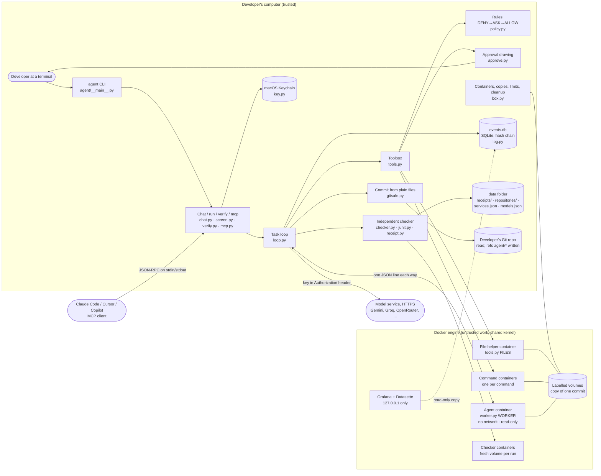
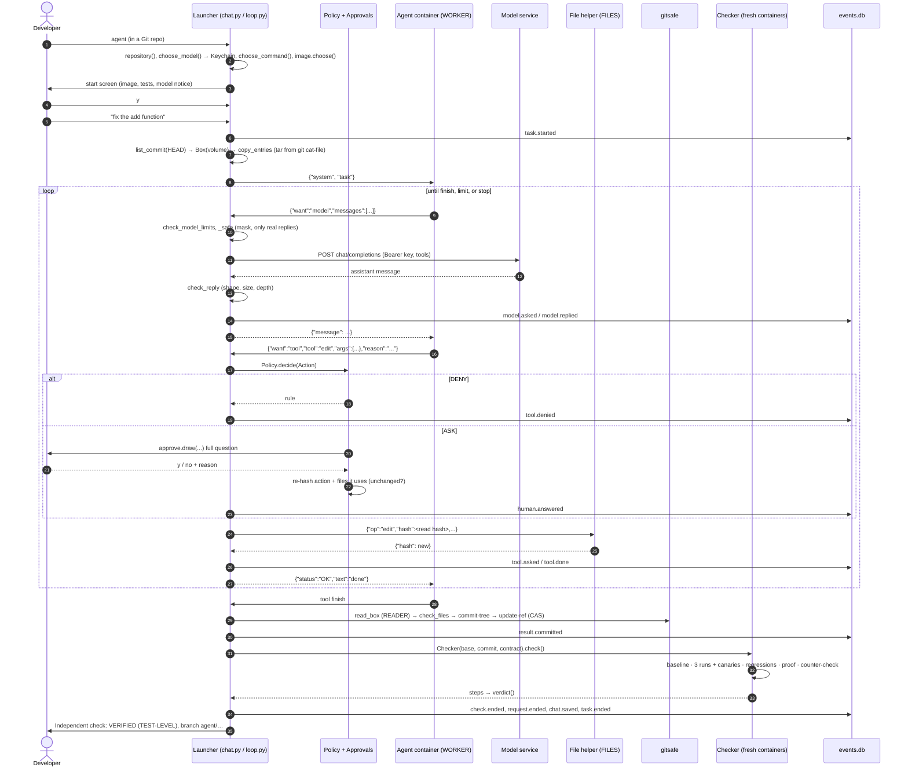

# 01 · System architecture

This page describes how the coding agent is built, as the code in `agent/` shows it at commit `e987153`.
The short page [architecture.md](architecture.md) lists the parts. [threat-model.md](threat-model.md) lists what is
protected from whom. This page goes deeper and covers the decisions behind the design.

**What kind of system this is.** It is one Python program that runs on the developer's own computer. It has no
server, no web API, no queue and no hosted database. All isolation comes from short-lived Docker containers. A
reviewer who expects "API gateway → services → database" should read the sections below with that in mind: each
classic layer is named, and what this repo uses in its place is shown.

---

## 1. System architecture diagram



### How the classic layers map to this repo

| Classic layer | Here | Code |
|---|---|---|
| Client interface | Terminal chat, one-shot CLI, MCP server on stdin/stdout | `agent/chat.py`, `agent/screen.py`, `agent/verify.py`, `agent/mcp.py` |
| API gateway / router | `main()` command table; `argparse` per command | `agent/__main__.py:27-55` |
| Auth layer | A person at a TTY answering `y`. There are no user accounts | `agent/approve.py:127` `ask_human` |
| Core service | Task loop (launcher-owned state machine) | `agent/loop.py` `Task` |
| Workers | Docker containers: agent, file helper, command, checker | `agent/box.py` `Box`, `Session` |
| Database | SQLite event log, append-only, hash-chained | `agent/log.py` `Log` |
| Object storage | JSON/text files in the data folder; Git objects in the developer's repo | `agent/receipt.py`, `agent/gitsafe.py` |
| Cache | Content-addressed image tags; remembered setup fingerprint; `functools.cache` of Docker facts | `agent/image.py:52`, `agent/screen.py:65`, `agent/box.py:275-297` |
| Queue | None. Everything is synchronous in one process | — |
| Secret store | macOS Keychain (`security` CLI); in memory only on Linux | `agent/key.py` |
| Third-party APIs | Any OpenAI-format chat completions endpoint over HTTPS | `agent/provider.py`, `agent/services.py` |
| Observability UI | Grafana and Datasette in containers, reading a copy of the log | `agent/dashboard.py` |

### Trust zones

| Zone | Trusted? | Why |
|---|---|---|
| Launcher process (all of `agent/*.py` running on the host) | Yes | Standard library only (`pyproject.toml` `dependencies = []`), and it is the only process holding the key |
| The developer at a TTY | Yes | The only party that can approve (`ask_human` refuses when stdin/stdout are not TTYs) |
| Model replies | **No** | Shape-checked by `model.check_reply`. What they ask for goes through `Policy` |
| Agent worker program | **No** | Runs in a container. The launcher checks that each assistant message is one the model really gave (`loop.Task._safe`) |
| Project files and project code | **No** | Copied, never mounted. Every test report is treated as a claim |
| MCP client | Partly | Its own host asks its user before a tool call. The server forces `--original-tests` (`mcp.py:93`) |

---

## 2. Request and data flow

### 2a. Primary flow: a chat request becomes a verdict



Step by step, with the code:

| # | Stage | What happens | Code |
|---|---|---|---|
| 1 | Entry | `main()` refuses Python < 3.11, sets signal handlers, removes leftovers of dead launchers | `__main__.py:19-55`, `box.signals_stop_cleanly`, `box.clean_leftovers` |
| 2 | Setup | Finds repo, model and key, test command, image. An unknown image stops here. Nothing is pulled | `chat.Chat.__init__`, `screen.choose_model`, `junit.test_command`, `image.choose`, `box.image_id` |
| 3 | Consent | Start screen, then one `y` | `screen.start_screen`, `approve.ask_human` |
| 4 | Copy | Tracked files of the base commit → tar stream → `tar -x` in a helper container into a new labelled volume. Secret-looking names, submodules and unsafe paths are left out | `box.list_commit`, `box._write_tar`, `box.Box.copy_entries` |
| 5 | Converse | The worker container keeps the message list and asks the launcher for each model reply or tool | `worker.WORKER`, `loop.Task._talk` |
| 6 | Validate | Every tool call goes through `Policy.decide`: type and size checks (DENY), sensitive paths (ASK), else ALLOW | `policy.Policy` |
| 7 | Approve | An ASK draws the question from the exact action, binds it to a hash, and checks the hash again after the answer | `tools.Toolbox._approve`, `approve.draw` |
| 8 | Effect | File ops go to the FILES helper, which never follows links. Commands get a new container each | `tools.FILES`, `box.Box.run` |
| 9 | Persist | Changed files are read back as plain bytes. The launcher makes the commit with Git plumbing only | `gitsafe.read_box`, `gitsafe.commit` |
| 10 | Check | Fresh volumes, original tests, 3 repeats, canaries, proof, counter-check | `checker.Checker.check` |
| 11 | Respond | Verdict from a fixed table. Receipt in JSON and text (owner-only). Log end hash stored in the receipt | `checker.verdict`, `receipt.build`, `receipt.save` |
| 12 | Retry | `FAILED` with tries left: the failing step texts go back to the model as tool output | `loop.Task._check` (`Limits.tries = 3`) |
| 13 | Follow-up | In the chat, `next_request` asks for the next request. The same worker and branch go on, with fresh limits | `loop.Task._again`, `chat.Chat.task` |

### 2b. Background and secondary flows

There are no background jobs or schedulers. Three flows run beside the main one:

```mermaid
flowchart TB
    subgraph Verify["agent verify BRANCH (also MCP tools/call verify)"]
        V1["find_base: merge-base of HEAD and branch"] --> V2["changes(): git diff-tree"]
        V2 --> V3["Checker.prepare(): protected files restored"]
        V3 --> V4{"changed tests?"}
        V4 -- "yes, terminal" --> V5["show_protected(): full diff, ask y"]
        V4 -- "MCP" --> V6["--original-tests forced"]
        V5 --> V7["Checker.check()"]
        V6 --> V7
        V4 -- "no" --> V8["confirm y"] --> V7
        V7 --> V9["receipt.save → receipts/RUNID/"]
    end
    subgraph Dash["agent dashboard"]
        D1["snapshot(): sqlite backup of events.db (mode=ro)"] --> D2["verify hash chain → integrity table"]
        D2 --> D3["Grafana :3000 / Datasette :8001 on 127.0.0.1"]
        D3 --> D4["every 5 s: snapshot again"]
    end
    subgraph Build["Project image (first run only)"]
        B1["Dockerfile in commit?"] -- yes --> B2["show whole file, ask y"] --> B3["docker build - (tar of tracked files)"]
        B1 -- "no, requirements.txt" --> B4["plain names only? show list, ask y"] --> B5["pip --only-binary=:all:"]
        B1 -- neither --> B6["language marker → node / golang / rust / maven image, must already exist"]
    end
```



### 2c. Error recovery at each stage

| Failure | Where caught | Result for the user |
|---|---|---|
| Model text, project output or worker sends anything unexpected | `loop.Task.run` catches any `Exception` | `BLOCKED: internal error (TypeName)`. Every task ends with an outcome |
| Model service 429/5xx | `provider.OpenAIFormat._call` retries up to 4 times, then the busy fallback model | One `Note:` line, then a lighter Gemini model, or `BLOCKED` with a "Next:" step |
| Docker or Git refuses | `box.BoxError` → `BLOCKED` | Message shown with "Next: run 'agent doctor'" |
| Result unsafe (secret, bad link, collision) | `gitsafe.Refused` | Up to 3 tries are fed back to the model, then `STOPPED` |
| Ctrl+C / SIGTERM / SIGHUP | `box.signals_stop_cleanly` → `KeyboardInterrupt`, delayed inside `box.uninterrupted()` | Containers and volumes removed. In the chat, an unchecked commit is moved off the branch (`gitsafe.move_back`) |
| Launcher killed with SIGKILL | Next start: `box.clean_leftovers()` removes items whose owner PID is gone | Nothing is left after the next command |

---

## 3. Architecture Decision Records

These ADRs were worked out from the code, `CASE-STUDY.md` and the commit history. Codes like AM1–AM15 are the
planning records the code and `CASE-STUDY.md` cite. Their source files are kept outside the repository.

### ADR-1 · Python standard library only, on the host
- **Decision:** The launcher, checker and everything on the host is Python ≥ 3.11 with no third-party packages (`pyproject.toml`: `dependencies = []`).
- **Context:** A solo developer who must be able to explain all the code. Zero cost. The CASE-STUDY records the switch from Go to Python (AM9).
- **Consequences:** + No supply chain on the trusted side, and installing is just an alias. − HTTP, JSON-RPC, SQLite access and terminal UI are all hand-written (`provider.py`, `mcp.py`, `approve.py`).
- **Alternatives:** Go (Claude's recommendation, turned down), Python with `httpx`/`rich`/`pydantic`.

### ADR-2 · A local monolith plus containers, not services
- **Decision:** One process owns all state and decisions. All untrusted work runs in throwaway Docker containers it starts.
- **Consequences:** + No network surface, no deployment, and one place where every effect is checked. − No multi-user use, and scaling is bounded by one machine.
- **Alternatives:** A hosted agent service (needs auth, a tenancy model and a sandbox fleet), or running on the host with OS sandboxing.

### ADR-3 · Copy the commit into a volume, never mount the folder
- **Decision:** `box.list_commit` plus `_write_tar` stream Git blobs straight from the object store into a labelled volume.
- **Context:** CASE-STUDY: "a mounted folder exposes `.env` and lets bugs change your files".
- **Consequences:** + The developer's working files are byte-identical before and after (a tested acceptance criterion). − Uncommitted changes are not seen (`screen.run` prints a note), and each command reads a copy.

### ADR-4 · The agent runs in a container, but the launcher performs every effect (AM5)
- **Decision:** The worker container has no network, no key and a read-only mount (`box.Session(b, WORKER, write=False)`). It can only *ask* for a model call or a tool, as one JSON line on stdin/stdout.
- **Context:** An internal cross-check found that an earlier design let the agent container write files directly.
- **Consequences:** + A compromised worker can't skip the policy, can't forge a model reply (`Task._safe` checks each assistant message against `self.given`), and can't fill memory (`Session.LINE`, `MAX_REQUEST`). − One extra process hop per step.

### ADR-5 · No Git inside containers. The launcher commits from plain files (AM10)
- **Decision:** `gitsafe.read_box` reads the files back as base64 JSON lines from a fixed reader program. `gitsafe.commit` uses `read-tree`, `hash-object --no-filters`, `update-index`, `write-tree`, `commit-tree` and `update-ref` with an expected old value.
- **Consequences:** + No hooks, filters, checkout or config from the project run on the host, and the current branch and index are never touched. − The design has to handle case-folding collisions, link targets and Git silently dropping names (`_refuse_collisions`, `_check_link`, comparing the tree after `write-tree`).
- **Alternatives:** `git bundle` out of the container (turned down: more to trust).

### ADR-6 · Synchronous, single-threaded control flow
- **Decision:** One task at a time per launcher. Threads are used only to pump container I/O (`box.Kept.read`, `_feed`, `Session._read`).
- **Consequences:** + Easy to reason about cancel and cleanup, and the event order is total. − Checker runs are sequential (6–8 container runs per Python check). Parallel runs would cut latency.

### ADR-7 · The verdict comes from a fixed table, not from a model
- **Decision:** `checker.verdict()`: any FAIL → FAILED. Else any FLAKY → FLAKY. Else any required step not PASS → UNVERIFIABLE. Else VERIFIED.
- **Consequences:** + Deterministic, auditable, and no prompt injection can change it. − It can only prove what tests show. Two known cheats pass (README "Limits").

### ADR-8 · An append-only SQLite log with a hash chain
- **Decision:** One `event` table. Each row's `hash = sha256(json([prev, seq, at, task, kind, body]))`. `BEGIN IMMEDIATE` and `synchronous=full`.
- **Consequences:** + Survives a kill without losing a confirmed event (tested 20 kills), and an edited row or a cut-off tail is detectable against a receipt. − A single file. Upkeep is a daily backup, rotation past 200 MB into a whole archive, and 365-day archive retention (`Log.upkeep`).

### ADR-9 · An OpenAI-format adapter for every model service (AM7, AM14)
- **Decision:** One `OpenAIFormat` class. Gemini is reached through Google's OpenAI-compatible endpoint. Replies go back unchanged, because Gemini thought signatures must round-trip.
- **Consequences:** + Adding a provider is data (`services.KNOWN` or `agent key add`). − No provider-native features. Only Gemini is marked `tested=True`.

### ADR-10 · The human is the only authorization factor
- **Decision:** No accounts, tokens or roles. An approval is `y` + Enter at a real TTY, after the input buffer is flushed (`termios.tcflush`).
- **Consequences:** + Nothing to provision. − No audit of *who* approved beyond the OS user, and no remote approval.

### ADR-11 · Never download without the developer
- **Decision:** `--pull never` on every container. Language images must already exist, or the program stops with the exact `docker pull` command (`junit.missing`). Project images are built only after the whole Dockerfile or package list was shown and confirmed.
- **Consequences:** + No surprise network use or disk growth. − More first-run steps (README §2.3, §7).

### What was deliberately *not* built (from the README's "Limits" section)
A web UI, held-back examples, native Windows, service containers (databases for tests), crash resume of a running
step, per-file counter-check, OpenTelemetry, and releases. The list was kept narrow on purpose to fit a 7-day
hackathon.

---

## 4. External interfaces and contracts

### 4.1 CLI (`agent/__main__.py` `USAGE`)

| Command | Arguments and flags | Exit codes | Code |
|---|---|---|---|
| `agent` | `--model SERVICE[:MODEL]` (default `gemini`), `--files PATH` (repeatable), `--proof TEST` (repeatable), `--command "..."`, `--image NAME`, `--continue` | 0 bye, 2 not started | `chat.main` |
| `agent run "REQUEST"` | same as above plus `--plain`, `--details` | 0 VERIFIED, 1 FAILED, 2 other | `screen.run` |
| `agent verify BRANCH` | `--command`, `--proof` (repeatable), `--base`, `--image`, `--original-tests` | 0 VERIFIED, 1 FAILED, 2 other | `verify.verify` |
| `agent merge BRANCH` | — | 0 | `verify.merge` (prints only) |
| `agent discard BRANCH` | — (asks `y`) | 0, 2 | `verify.discard` |
| `agent doctor` | — | 0 ready, 1 a STOP line | `doctor.main` |
| `agent demo` | `--keep` | 0 expected results, 1 not | `demo.demo` |
| `agent model-test SERVICE[:MODEL]` | — | 0 TESTED, 1 otherwise | `demo.model_test` |
| `agent key set\|status\|remove SERVICE`, `agent key list`, `agent key add NAME --url --model --company [--per-minute N]` | — | 0, 2 | `key.main` |
| `agent dashboard` | `--grafana-port` (3000), `--datasette-port` (8001), `--no-browser` | runs until Ctrl+C | `dashboard.main` |
| `agent mcp` | none (stdin/stdout) | 0 at EOF | `mcp.main` |

Chat slash commands (`chat.HELP`): `/diff`, `/verify`, `/merge`, `/discard`, `/new`, `/proof T`, `/help`, `/quit` (also `quit`, `exit`, `bye`, `q`).

### 4.2 MCP server (JSON-RPC 2.0, one message per line, `agent/mcp.py`)

| Method | Result |
|---|---|
| `initialize` | `protocolVersion` (echoed if one of `2025-11-25`, `2025-06-18`, `2025-03-26`, `2024-11-05`), `capabilities.tools`, `serverInfo {name:"coding-agent-v2", version:"1"}` |
| `ping` | `{}` |
| `tools/list` | the two tools below |
| `tools/call` | `{"content":[{"type":"text","text":...}],"isError":bool}` |
| notification (no `id`) | no answer |

Errors: `-32700` not JSON, `-32600` not JSON-RPC 2.0 or line > 1,000,000 chars, `-32602` bad params or unknown tool, `-32601` unknown method.

```json
{
  "name": "verify",
  "inputSchema": {
    "type": "object",
    "properties": {
      "branch":     {"type": "string"},
      "proof":      {"type": "array", "items": {"type": "string"}},
      "command":    {"type": "string"},
      "base":       {"type": "string"},
      "repository": {"type": "string"}
    },
    "required": ["branch"],
    "additionalProperties": false
  }
}
```
```json
{"name": "receipt", "inputSchema": {"type": "object", "properties": {"id": {"type": "string", "pattern": "^[0-9a-f]{12}$"}}, "required": ["id"], "additionalProperties": false}}
```
At most 20 `verify` calls an hour per server (`CHECKS_PER_HOUR`). Validation on the server side: names must match `[^\s\-][^\s]{0,250}`, so no argument can start with `-` and turn into an option. At most 50 proofs. `command` is a single line of ≤ 500 chars.

### 4.3 Launcher ↔ worker protocol (stdin/stdout JSON lines, `agent/worker.py`, `agent/loop.py:_talk`)

```ts
// launcher → worker, first line
type Start = { system: string; task: string; history?: OpenAIMessage[] };
// worker → launcher
type Want =
  | { want: "model"; messages: OpenAIMessage[] }
  | { want: "tool"; tool: string; args: Record<string, unknown>; reason: string }
  | { want: "malformed"; tool: string }
  | { want: "nothing"; text: string };
// launcher → worker
type Answer =
  | { message: OpenAIMessage }            // a model reply
  | { user: string }                      // the human's follow-up request
  | { status: "OK"|"FAILED"|"DENIED"|"REJECTED"|"ERROR"|"SKIPPED"; text: string;
      exit_code?: number; truncated?: true; notice?: string }
  | { text: string };                     // answer to "nothing"
```

### 4.4 Launcher ↔ file helper protocol (`agent/tools.py` `FILES`)

| `op` | Request fields | Success answer |
|---|---|---|
| `list` | `path`, `blocked` (regex) | `{files: [[name, size]…≤500], total}` |
| `search` | `text`, `path`, `blocked` | `{hits: [[name, line, text]…≤50], files, total, skipped}` |
| `read` | `path` | `{text, hash}` (sha256 of bytes) |
| `create` | `path`, `text` | `{hash}` (fails if the file exists) |
| `edit` | `path`, `old`, `new`, `hash` | `{hash}` (fails unless the file's hash equals `hash` and `old` occurs exactly once) |
| `delete` | `path`, `hash` | `{}` |
| any error | — | `{no: "reason"}` |

### 4.5 Model service contract (`agent/provider.py`)

`POST {address}` with `Authorization: Bearer <key>` and body `{"model", "messages", "tools"}` in OpenAI
chat-completions format. The adapter uses `choices[0].message`, `choices[0].finish_reason` (`"length"` → the reply is
cut off and none of its calls run), and `usage.total_tokens`, `prompt_tokens` and `completion_tokens`. There are no redirects (`NoRedirects`), the reply is
capped at 5 MB and must arrive within 180 s.

### 4.6 Tools offered to the model (`agent/policy.py` `TOOLS`, `agent/model.py` `tool_list`)

| Tool | Arguments (exact) | Default decision |
|---|---|---|
| `list` | `path: str` | ALLOW |
| `search` | `text: str`, `path: str` | ALLOW |
| `read` | `path: str`, `first: int` | ALLOW |
| `edit` | `path: str`, `old: str`, `new: str` | ALLOW inside agreed files, otherwise ASK |
| `create` | `path: str`, `text: str` | same as edit |
| `delete` | `path: str` | ASK unless the agent created the file |
| `run_command` | `program: list[str]` | ASK, every time |
| `run_checks` | — | ALLOW (the confirmed command) |
| `ask` | `question: str` | ALLOW (asks the human an open question) |
| `finish` | `summary: str` | ALLOW (starts the checker) |

Every call may also carry `reason`, which is shown to the human labelled as "the agent's claim".

### Not present
There are no REST, GraphQL, gRPC, WebSocket or webhook interfaces. Grafana (`:3000`) and Datasette (`:8001`) are
third-party UIs bound to `127.0.0.1`, read-only over a copy of the log, and they need a sign-in that only the terminal shows. They are not an API of this product.
