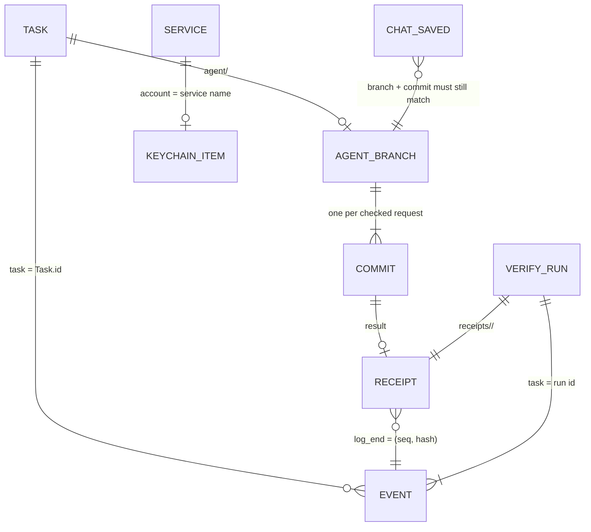
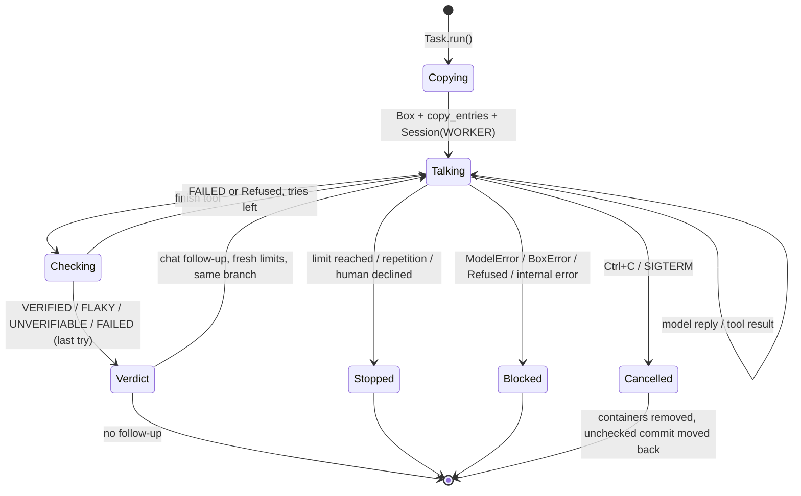
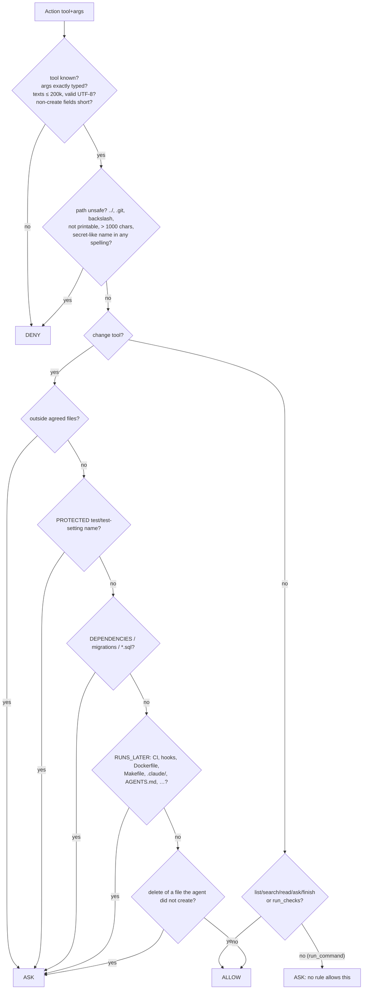
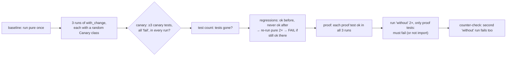
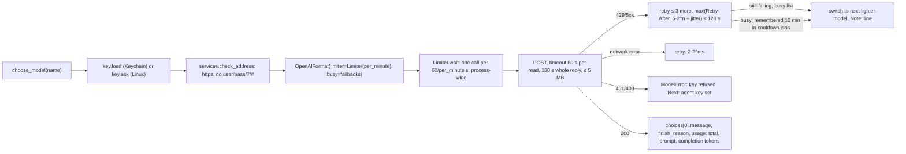

# 02 · Core logic and data models

Everything here is taken from the code. File paths are relative to the repository root.

---

## 1. Data models and storage

The system has **no server database**. State lives in five places on the developer's computer:

| Store | Location | Written by | Format |
|---|---|---|---|
| Event log | `<data>/events.db` | `agent/log.py` `Log.add` (launcher only) | SQLite, one table |
| Receipts | `<data>/receipts/<id>/receipt.json` and `receipt.txt` | `agent/receipt.py` `save` | JSON + plain text, mode 0600 |
| Remembered setup | `<data>/repositories/<sha256(repo path)[:16]>.json` | `agent/screen.py` `run` | `{"setup": "<fingerprint>"}` |
| Added model services | `<data>/services.json` | `agent/services.py` `add` | JSON map, **never a key** |
| Busy models (cool-down) | `<data>/cooldown.json` | `agent/provider.py` `_cool` | `{"service:model": until}`, mode 0600 |
| Log backups and archives | `<data>/backups/events-YYYY-MM-DD.db`, `events-until-<time>.db` | `agent/log.py` `upkeep` | SQLite copies, mode 0600 |
| Model test results | `<data>/models.json` | `agent/demo.py` `model_test` | JSON map |
| Demo report | `<data>/demo.html` | `agent/demo.py` `demo` | HTML |
| Dashboard copy | `<data>/dashboard/data/events.db` + Grafana provisioning | `agent/dashboard.py` | SQLite copy + views |
| API keys | macOS Keychain, service `coding-agent-v2`, account = service name | `agent/key.py` | generic password |
| Agent results | Developer's Git repo: objects + `refs/heads/agent/<id>` | `agent/gitsafe.py` `commit` | Git commits |
| Working copies | Docker volumes `coding-agent-v2-<task>-<rand>` | `agent/box.py` `Box` | files; deleted at the end of each task |
| Project images | `coding-agent-v2/project:<sha256(tree)[:16]>` | `agent/image.py` | Docker images, labelled `coding-agent-v2=image` |

`<data>` is `~/Library/Application Support/coding-agent-v2` on macOS. Elsewhere it is
`$XDG_DATA_HOME/coding-agent-v2`, or `~/.local/share/coding-agent-v2` when that variable is not set
(`agent/verify.py` `data_folder`). Folders are created with mode 0700.

### 1.1 Event log schema (`agent/log.py`)

```sql
-- pragma user_version = 1   (VERSION; a newer file is refused)
-- pragma journal_mode = wal  (or 'delete' on SQLite builds with the WAL-reset bug: doctor.sqlite())
-- pragma synchronous = full; pragma fullfsync = 1
CREATE TABLE IF NOT EXISTS event (
  seq  INTEGER PRIMARY KEY,   -- 1, 2, 3, … no gaps (verify() checks seq == row count)
  at   REAL,                  -- time.time()
  task TEXT,                  -- 12 hex chars: Task.id or a verify run id
  kind TEXT,                  -- see the event catalogue below
  body TEXT,                  -- JSON, keys sorted, secrets masked inside the structure
  prev TEXT,                  -- hash of seq-1, or 64 zeros for the first
  hash TEXT                   -- sha256(json.dumps([prev, seq, at, task, kind, body]))
);
```

- **Indexes:** the primary key, plus `event_task` on `event(task)` and `event_kind` on `event(kind)`, created with `if not exists` when a log is opened. Indexes change no row and no hash, so older copies of the program read the file as before.
- **Upkeep:** a daily backup to `backups/` (14 kept), rotation past 200 MB into a whole archive, and archives deleted after 365 days (`Log.upkeep`). See [03-permissions-and-state-safety.md](03-permissions-and-state-safety.md).
- **Constraints:** written only through `Log.add` inside `BEGIN IMMEDIATE`. Each write reads `end()` and then inserts `seq+1`, so two processes produce one chain (`tests/test_log.py` `test_two_programs_writing_at_the_same_time`).
- **Tamper evidence:** `Log.verify(saved)` walks the chain, and `receipt["log_end"] = [seq, hash]` lets a receipt find a cut-off tail.

#### Event catalogue

| `kind` | Body fields | Emitted in |
|---|---|---|
| `task.started` | `contract`, `base`, `model` | `loop.Task.run` |
| `model.asked` | `number`, `model`, `messages` (count) | `loop.Task._model` |
| `model.replied` | `number`, `tokens`, `prompt`, `completion` (input and output tokens, 0 when the service does not say), `cut`, `message` | `loop.Task._model` |
| `tool.denied` | `tool` (≤ 50 chars), `rule`. The arguments are **not** recorded | `tools.Toolbox.call` |
| `tool.asked` | `tool`, `args`, `decision`, `rule` | `tools.Toolbox.call` |
| `human.answered` | `yes`, `reason`, `action` (hash) | `tools.Toolbox._approve` |
| `command.ended` | `program`, `status`, `code`, `seconds` | `tools.Toolbox._run` |
| `tool.done` | `tool`, `status`, `code`, `text` (masked, ≤ 30,000 chars) | `tools.Toolbox.call` |
| `result.refused` | `reason` | `loop.Task._check` |
| `result.committed` | `branch`, `commit`, `not_taken` | `loop.Task._check` |
| `check.ended` | `verdict`, `steps` | `loop.Task._check` |
| `request.ended` | `state`, `commit` | `loop.Task._talk` (chat only) |
| `chat.saved` | `repo`, `branch`, `commit`, `base`, `what`, `state`, `messages` | `loop.Task._save` |
| `task.ended` | `state`, `reason`, `commit` | `loop.Task.run` |
| `task.cancelled` | — | `loop.Task.run` |
| `verify.started` / `verify.done` / `verify.cancelled` | `base`, `result`, `contract` / `verdict`, `steps` | `verify.verify` |

#### Dashboard views (`agent/dashboard.py` `VIEWS`, created only on the *copy*)
`integrity(checked, events, state)`, plus the views `tasks`, `verdicts`, `tool_calls` and `model_calls`, all built
with `json_extract` over `event.body`.

### 1.2 Receipt (`agent/receipt.py` `build`)

```python
from typing import Literal, TypedDict

class Step(TypedDict):
    name: str            # change, original files, copied, baseline, tests, canary, test count,
                         # regressions, proof, counter-check, running
    state: Literal["PASS", "FAIL", "FLAKY", "UNCLEAR", "NOT CHECKED"]
    text: str
    required: bool       # False only for "canary: NOT CHECKED"

class Receipt(TypedDict):
    receipt: Literal[1]
    verdict: Literal["VERIFIED", "FAILED", "FLAKY", "UNVERIFIABLE"]
    level: Literal["TEST-LEVEL", "COMMAND-LEVEL"]
    base: str; result: str                     # full commit ids
    contract: dict                             # what, where[], command[], proof[], approved{path: blob id | ""}
    steps: list[Step]
    tests: dict                                # {"before": n, "after": n} (test-level only)
    changes: list[dict]                        # path, old_mode, new_mode, new_id
    original_kept: list[str]                   # protected files restored from the base
    left_out: list[str]                        # "name: reason" (not copied)
    refusals: list[str]                        # tool calls denied or rejected during the task
    environment: dict                          # image (sha256 id), docker, cpu, isolation, same_as_ci="NOT CHECKED"
    not_proven: list[str]                      # fixed list in NOT_PROVEN (+ COMMAND_ONLY)
    log_end: list | None                       # [seq, hash]
    tries: int                                 # agent tasks only
```

### 1.3 In-memory domain types

| Type | Fields | File |
|---|---|---|
| `Contract` | `what`, `where` (names, `folder/` or globs), `command`, `proof`, `approved` | `agent/checker.py:41` |
| `Action` | `tool`, `args`; `hash()` = sha256 of sorted JSON | `agent/policy.py:35` |
| `Decision` | `kind` (DENY/ASK/ALLOW), `rule` | `agent/policy.py:43` |
| `Limits` | `model_calls=100`, `tool_calls=1000`, `log_bytes=50 MB`, `minutes=45`, `tokens=2,000,000`, `tries=3`, `malformed=3`, `cut=2` | `agent/loop.py:25` |
| `Outcome` | `state` (verdict / STOPPED / BLOCKED), `reason`, `branch`, `commit`, `receipt` | `agent/loop.py:40` |
| `box.Result` | `status` (EXITED, TIMED_OUT, CANCELLED, OUT_OF_MEMORY, TOO_MUCH_DISK, LOW_SPACE), `code`, `output`, `truncated`, `seconds` | `agent/box.py:40` |
| `Entry` | `mode`, `oid`, `size`, `name` (one Git tree entry) | `agent/box.py:192` |
| `gitsafe.File` | `path`, `mode` ("" = deleted), `data` | `agent/gitsafe.py:37` |
| `Service` | `name`, `address`, `model`, `per_minute`, `company`, `free_tier_note`, `busy`, `tested` | `agent/services.py:15` |

### 1.4 Relationships



### 1.5 Migration strategy
- The log carries `pragma user_version = 1`. An older file (0) is adopted, and a newer one is refused with "Next: update the program" (`log.py:43-45`).
- The receipt carries `"receipt": 1`.
- **[GAP / RECOMMENDED]** There is no code that upgrades between versions. Before changing the `event` table, add a step-wise migrator that keeps the hash chain valid. Never rewrite `body` or `hash` of existing rows: add columns or side tables only.

```python
# agent/log.py: template for VERSION 2
MIGRATIONS = {
    1: ["create index if not exists event_task on event(task)",
        "create index if not exists event_kind on event(kind)"],
}
def _migrate(db, found: int) -> None:
    for v in range(found, VERSION):
        for sql in MIGRATIONS.get(v, []):
            db.execute(sql)            # schema-only: rows and hashes untouched
        db.execute(f"pragma user_version={v + 1}")
```

The two indexes in this template already exist (they need no version change). Keep the template for the next real
schema change.

---

## 2. Core workflows and domain rules

### 2.1 The task state machine (`agent/loop.py`)



**Termination guarantees** (`Limits`, `Repeats`, `_nothing`):
- Hard limits: 100 model calls, 1000 tool calls, 2 M tokens, 45 *active* minutes (time spent waiting for the human is subtracted in `_waiting`), and 50 MB of log per task.
- Repetition (`Repeats.add`): stop when the same call gives the same result 4 times in the last 12, the same error 3 times in a row, or an A/B/A/B alternation over 12 calls. One warning is given first, and the second detection stops the task.
- A reply with no tool call: the first time, the model is reminded. After that the human decides. More than 10 such replies stop the task.
- Malformed tool arguments 3 times in a row → stop. A cut reply (`finish_reason == "length"`) is retried `cut` = 2 times and never run.
- After a change tool fails, later change tools in the same reply are `SKIPPED` (worker side).

### 2.2 Policy: DENY → ASK → ALLOW (`agent/policy.py`)



Every rule runs on two spellings: the original, and its NFKC form folded to lower case
(`spellings()`), so `Makefile` is treated as `Makefile`.

### 2.3 Approval binding (`agent/tools.py` `_approve`, `agent/approve.py`)
1. `_shown(action)` reads every project file the command may run (a word, `x/__main__.py`, `a.b` → `a/b.py`, …) and hashes their names and contents into `state`.
2. `approve.draw` builds the question. Every row starts with a launcher label (`File      `, `Command   `, `  + `), so content can never begin a row. Invisible, combining and right-to-left characters become `<U+XXXX>`. If the question exceeds 400 lines or would show a secret, it is **not asked** and the result is `REJECTED`.
3. After `y`, the hashes `(action.hash(), state)` are computed again. If they differ, the result is `REJECTED: something changed while the question waited`.
4. The `_chain` rule tracks per file whether the human saw *every* change since the base. A command in between breaks the chain (`"broken"`). Only an unbroken chain makes a file count as `approved` for the checker.

### 2.4 Committing the result (`agent/gitsafe.py`)

| Step | Rule |
|---|---|
| `read_box` | A fixed `READER` program walks `/work` without following links and reports tracked files whose (mode, Git hash) differ, plus new files only if the agent created or edited them (`edited`). Command-made files such as caches go to `not_taken`. The output must end with `{"end": true}` |
| `check_files` | Refuses unsafe names, secret file names, non-regular modes, and **new** secrets (a match of `scan.RULES` that was not already in the base version of that file) or an exact known key. Notes executables and `RUNS_LATER` files for the merge screen |
| `_refuse_collisions` | Refuses names that are the same file on macOS or Windows (NFC + casefold), and a file inside a non-folder |
| `_check_link` | A link must stay inside the project, must not pass through another link, and must not point at `.git`-like names |
| `Git` | Every call runs with `core.hooksPath=/dev/null`, `core.fsmonitor=false`, `commit.gpgSign=false`, and every `hook.*.enabled=false` found in config, passed through `GIT_CONFIG_COUNT` |
| `commit` | Temporary index → `update-index --index-info` → `write-tree`. The tree is compared with the intended `{path: (mode, oid)}`, then `commit-tree`, then `update-ref <ref> <new> <expected old>` (compare-and-swap) |

### 2.5 The independent checker (`agent/checker.py`)

**Three file sets** are built in `prepare()`, all read from the developer's repository, never from the container:

| Set | Contents | Used for |
|---|---|---|
| `pure` | the base commit | baseline, regression repeats |
| `without` | base + tests the human approved | proof must **fail** here |
| `with_change` | result, but every protected file comes from the base unless approved | the 3 main runs |

Protected = `PROTECTED` names ∪ files named in the command or proof ∪ base `*.py` files that `import unittest/pytest`
∪ new top-level files named like a standard-library module.

**Test-level pipeline (`by_tests`)** for unittest, pytest, JUnit XML (`{report}`) and `go test -json`:



**Report integrity (Python).** `RUNNER` is fed by stdin into the project image's Python. It drops `""` and `/work`
from `sys.path` before importing `unittest`, puts the project folder after the stdlib, collects results by test id,
and writes `\n@@<nonce> {json}@@\n` to a duplicate of fd 1. `read_report` requires exactly one marker with that
nonce, outcomes in `{ok, xfail, skip, fail, error}`, and an exit code that agrees. Project code runs in the same
process and *can* read the nonce (the demo's "forges the test report" case does this with `gc.get_objects()`). The
canaries catch it: a forged "all ok" also marks the canaries `ok`, so the result is `UNCLEAR` → **UNVERIFIABLE**.

**JUnit / Go (`agent/junit.py`).** The report path is `/work/.agent-report-<128-bit random>.xml`, chosen for that
one run. XML containing `<!DOCTYPE` or `<!ENTITY` is refused before parsing. Each `testcase` needs a name. For Go, only
`go test -json` events with `Test` and an `Action` of pass/fail/skip count, so text a test prints cannot pose as a
result. `_agrees` requires failures if and only if the exit code is non-zero. Canaries are `NOT CHECKED` for these
tools.

**Command-level pipeline (`by_command`)** for any other command (Rust, Java, scripts): the baseline must exit 0. Then
3 runs with the change. Then the proof command (or the main command) runs 2× without and 2× with the change. It must
fail without the change and pass with it.

**Verdict table (`verdict`)**, applied in order:

| If any step is… | Verdict |
|---|---|
| `FAIL` | FAILED |
| `FLAKY` | FLAKY |
| a required step that is not `PASS` (incl. `UNCLEAR`), or no steps | UNVERIFIABLE |
| otherwise | VERIFIED |

**Approved new tests as proof (`approved_tests`).** When no proof was named, the proof becomes the *new* tests in test
files whose full new content the human approved, and only when those tests did not exist before. Old tests in an
approved file never count, because they could have been weakened. This rule closes a review finding listed in
`CASE-STUDY.md`.

### 2.6 Model integration pipeline (`agent/provider.py`, `agent/services.py`)



### 2.7 Chat continuation (`agent/chat.py` `resume`, `agent/loop.py` `_save`)
- A `chat.saved` event is written **only after a verdict**. It holds the masked message list sent last, the reply, and synthetic tool answers (`UNKNOWN` for calls whose result was not kept, so a provider accepts the list).
- `--continue` takes the newest `chat.saved` for this repo path and goes on only if `agent/<id>` still points at the saved commit. Otherwise a new chat starts.
- Assistant messages from history are added to `Task.given`, so they pass `_safe`. Anything else the worker invents is refused (`test_a_reply_that_the_model_did_not_give_is_not_continued`).
- A step that was cut off is never run again, because only checked work is saved. Approvals are asked again.

### 2.8 Container lifecycle (`agent/box.py`)

| Item | Flags / limits |
|---|---|
| Every container (`HARDENED`) | `--network none --read-only --cap-drop ALL --security-opt no-new-privileges --user 1000:1000 --pids-limit 512 --ulimit core=0 --tmpfs /tmp:size=512m --init --log-driver none --no-healthcheck --pull never`, proxy variables set to empty |
| CPU and memory (`_limits`) | `--cpus min(4, NCPU)`, `--memory` = `--memory-swap` = `min(3 GB, MemTotal/2)` |
| Image-declared volumes | replaced by `--tmpfs <path>:size=64m`. Odd names are refused. A container whose mounts are not exactly our volume is refused |
| Disk | volume ≤ 3 GB (`MAX_FILES`), checked every 2 s by `look()`; host must keep ≥ 8 GB free (`doctor.space`), Docker disk ≥ 2 GB and 200k inodes |
| Time | 600 s per command (`COMMAND_SECONDS`); 1800 s per whole check (`checker.TOTAL_SECONDS`) |
| Output | first 5 MB + last 5 MB kept (`Kept`) |
| Root helpers | only our fixed `sh -c "du …; df …"`, run as `0:0` with one capability (`CHOWN` or `DAC_READ_SEARCH`) and 256 MB memory |
| Labels | `coding-agent-v2=task`, `coding-agent-v2.task=<id>`, `coding-agent-v2.owner=<pid>`. Cleanup requires name prefix **and** label |
