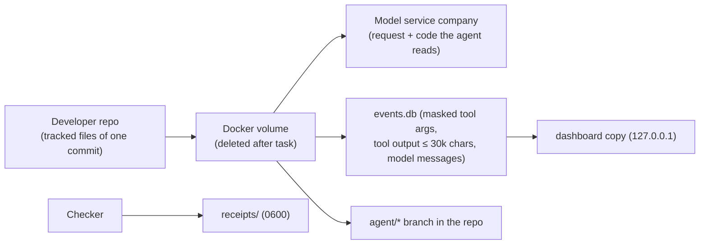

# 04 · Security and compliance

The asset/attacker/control table is in [threat-model.md](threat-model.md). This page lists the guardrails one by
one, with the exact code, and then covers privacy and compliance.

## 1. Application security and guardrail policy

### 1.1 Input validation and sanitization

| Input | Validation | Code |
|---|---|---|
| Model reply | must be a dict with `role: assistant`, depth ≤ 30, JSON ≤ 1 MB, `content` a string or null, ≤ 20 tool calls, and each call must have string `id`, `name` and `arguments` | `model.check_reply` |
| Raw HTTP reply | ≤ 5 MB, ≤ 180 s total (slow-drip safe), JSON with `choices[0].message` as a dict | `provider.OpenAIFormat._read`, `_call` |
| Tool arguments | exact key set and exact Python types; texts ≤ 200,000 chars and valid UTF-8 (no lone surrogates); `text` ≤ 1000, `question` ≤ 2000, `summary` ≤ 5000 (except `create`); `read.first` 1…10⁷; `program` 1–200 strings, each < 10,000 chars, no NUL | `policy.Policy._deny` |
| Paths | no empty, `.` or `..` parts; no `.git` (also `.GIT.`, `.git ` etc.); no backslash; printable; ≤ 1000 chars; not a secret name in either spelling | `box.unsafe_path`, `policy._deny_path`, `policy.spellings` |
| Worker messages | assistant messages must be byte-identical to a reply the model gave; others are rebuilt from `role` + masked `content` | `loop.Task._safe` |
| Worker conversation | ≤ 3,000,000 chars JSON per model request | `loop.MAX_REQUEST` |
| Helper answers | ≤ 10 MB per line, answer within 30 s, must be a JSON object; after a late or missing answer the session is closed | `box.Session.ask` |
| Commit tree from Git | `ls-tree` sizes must be numbers; conflicting paths are refused | `box.list_commit`, `refuse_conflicts` |
| Files leaving the container | see the `gitsafe` table in [02-core-logic-and-data-models.md](02-core-logic-and-data-models.md) | `gitsafe.check_files` |
| Test reports | nonce marker exactly once; outcomes from a fixed set; must agree with the exit code; JUnit with no DOCTYPE or ENTITY, ≤ 5 MB | `checker.read_report`, `junit.read_junit` |
| MCP requests | ≤ 1,000,000 chars per line; JSON-RPC 2.0; names match `[^\s\-][^\s]{0,250}`; `additionalProperties: false` enforced by hand | `mcp.serve`, `mcp.run_verify` |
| `requirements.txt` for image builds | each line must be a plain package spec: no `@`, `/`, `\`, `:` and no options (`-e`, `--index-url`, …) | `image.PACKAGE` |

### 1.2 Output encoding: terminal injection

Text from the model, file names and project output can contain ANSI escapes, bidi overrides or invisible characters.
Everything shown goes through one of the following:
- `receipt.visible`: non-printables become `<U+XXXX>`.
- `verify.visible`: also escapes characters that render as blank (Hangul fillers, braille blank, variation selectors).
- `approve.exact`: also combining marks, RTL/AL/AN bidi classes, and the tab marker. Rows never start with content. Wide characters count as 2 columns, so padding cannot fake a row (`test_policy.Draw.test_padding_cannot_forge_a_row_on_any_screen`).
- The demo HTML uses `html.escape` (`test_demo.test_report_is_escaped`).

### 1.3 Sandboxing and isolation (untrusted code execution)

All project code, and the agent itself, runs in Docker with the `HARDENED` flags (`agent/box.py:300`):

| Control | Flag / mechanism |
|---|---|
| No network | `--network none` |
| No privilege | `--cap-drop ALL`, `--security-opt no-new-privileges`, `--user 1000:1000` |
| Immutable root | `--read-only`, writable only `/tmp` (tmpfs 512 MB) and `/work` (our volume) |
| Fork bomb | `--pids-limit 512` |
| Memory | `--memory` = `--memory-swap` = min(3 GB, half of Docker's memory); OOM or exit 137 → `OUT_OF_MEMORY` |
| CPU | `--cpus min(4, NCPU)` |
| Disk | volume watched every 2 s, ≤ 3 GB; `--ulimit core=0`; image-declared volumes → 64 MB tmpfs |
| Time | 600 s per command, 1800 s per check |
| No pulls | `--pull never`; images are resolved to `sha256:` ids before use |
| No host files | the folder is never mounted; the mount list is inspected and must be exactly our volume |
| No proxy credentials | `HTTP_PROXY`… set to empty inside |
| No Docker socket | never mounted (`test_path.Container.test_what_the_agent_container_can_do`) |
| No shell | commands are argv lists (`docker create … <image> *args`); `run_command` is never passed to `sh -c` |

**Residual risk:** containers share the host kernel ("this limits harm, it is not complete protection", README and
`box.py` docstring). **[GAP / RECOMMENDED]** Put gVisor (`--runtime=runsc`) or Docker Sandboxes behind the same
`box.run` interface. `CASE-STUDY.md` names this as the next step.

### 1.4 Prompt-injection defenses
- The system prompt states that tool results are data (`worker.SYSTEM`). **No control depends on the model obeying this.**
- Every effect goes through the policy and, where risky, the human. An injected `curl … | sh` in a file does not run, because there is no network and every command asks (`test_policy.Tools.test_the_injected_command_does_not_run`, `test_path.Path_.test_injected_text_in_a_file_is_only_data`).
- The verdict is computed without a model (`checker.verdict`). A "tests pass" claim by the model is ignored (`test_path.Path_.test_a_lie_does_not_help`).
- Files that steer *other* agents after a merge (`.claude/`, `.cursor/`, `.mcp.json`, `AGENTS.md`, `CLAUDE.md`, `GEMINI.md`) ask before change and are flagged on the merge screen (`gitsafe.RUNS_LATER`).

### 1.5 Host-side Git hardening
`gitsafe.Git` sets `core.hooksPath=/dev/null`, `core.fsmonitor=false`, `core.splitIndex=false`, sparse checkout off,
`core.protectHFS/NTFS=true`, `commit.gpgSign=false`, `gc.auto=0`, `maintenance.auto=false`, and disables every
`hook.<name>.enabled` found in config. `box.git_env` removes all inherited `GIT_*` variables and sets
`GIT_OPTIONAL_LOCKS=0`, `GIT_NO_LAZY_FETCH=1` and `GIT_NO_REPLACE_OBJECTS=1`. Colour settings are forced off, so no
escape codes reach parsing (`test_verify.Command.test_colour_settings_do_not_switch_off_protection`).

### 1.6 SSRF and outbound network
- Only the launcher makes outbound calls, and only to the configured model service.
- `services.check_address`: scheme must be `https`, a hostname is required, and no userinfo, query or fragment is allowed. It is checked when a service is added **and** again when it is used, so an edited `services.json` cannot send the key over plain HTTP (`test_services.test_a_changed_file_cannot_send_the_key_without_https`).
- `provider.NoRedirects`: a redirect could send the `Authorization` header elsewhere, so redirects are not followed.
- TLS uses `ssl.create_default_context()` (system CA store, hostname check).
- `OpenAIFormat` accepts `http://127.0.0.1` only for tests. The production path calls `check_address` first (`screen.choose_model`).
- The dashboard health check uses `ProxyHandler({})`, so the local URL is never sent through a proxy.
- Image builds (`docker build`) have Docker's normal network. They run only after the full file was shown and approved.

### 1.7 Injection defenses (command, SQL, XML, path)

| Class | Defense |
|---|---|
| Shell or command injection | every `subprocess` call takes an argv list (ruff `S603`/`S607` ignored on purpose; see `pyproject.toml`); branch and test names from MCP cannot start with `-`; `--end-of-options` in `rev-parse` |
| Option injection into Git | `rev-parse --verify --end-of-options`; `refs/heads/` prefix in `verify.branch_commit` (a tag with the same name is not taken) |
| SQL injection | every `Log` query is parameterized; dashboard SQL is constant (the `tz` integer is the only interpolation, `noqa: S608` documented) |
| XML (XXE, billion laughs) | JUnit text containing `<!DOCTYPE` or `<!ENTITY` is refused before `ET.fromstring` |
| Path traversal and symlink races | the helper walks with `openat`-style `dir_fd` + `O_NOFOLLOW` one folder at a time; links in results must stay inside and must not pass through another link |
| Unicode confusables in file names | NFKC + casefold for the rules; NFC + casefold for collisions |

### 1.8 Rate limiting
- **Outbound:** `provider.Limiter` spaces calls by `60 / per_minute` seconds, process-wide (default Gemini 5/min, i.e. 12 s; others per `services.KNOWN`; added services 1–600, default 10).
- **Inbound:** there is no network listener (MCP is stdin). MCP `verify` is limited to 20 calls an hour per server (`mcp.CHECKS_PER_HOUR`).

### 1.9 CORS and CSRF
Not applicable to the product: there is no HTTP server. The third-party dashboard UIs listen on 127.0.0.1 only and
read a copy of the log. Both need a sign-in that only the terminal shows. Grafana gets a password made for each start
(through an owner-only env file deleted right after `docker run`, so it is never in a command line). Datasette gets a
link that works once. A web page that reaches them under another host name (DNS rebinding) gets no data: Grafana sends
it back to `127.0.0.1` (`GF_SERVER_ENFORCE_DOMAIN`), and both refuse anyone who is not signed in. Tested live:
anonymous 401 and 403, a reused link 403, a wrong password 401.

### 1.10 Secret management

| Rule | Implementation |
|---|---|
| Key storage | macOS Keychain via `security -i`, with the key on **stdin**, never in argv (`key.store`; `test_key.Keychain.test_the_key_is_never_in_a_command_line`) |
| Key shape | `[A-Za-z0-9_.\-]{20,300}` (`key.SHAPE`) |
| Linux | not stored; typed at each chat start with `getpass`, kept in memory |
| Key use | only `provider.OpenAIFormat`, only in the `Authorization` header |
| Never in | repo, container env, argv, log, receipt, recording, screen (NFR-2; `test_key.KeyNeverLeaks.test_full_task_error_and_cancel`) |
| Error messages | provider errors are masked; if any 8-char window of the key appears, the whole message is withheld (`provider._said`) |
| Masking | `mask.mask`: exact secrets first (longest first), then `scan.RULES` patterns, applied before storing, showing or sending; `StreamMask` holds back the tail so a split secret is still found |
| Commits | a new pattern secret or the exact key in a changed file **refuses the commit** (`gitsafe.check_files`) |
| Repository scan | `python3 -m agent.scan` in `./check` scans staged and working copies and prints places, never values |
| Tests | `tests/__init__.py` points `CODING_AGENT_KEYCHAIN` at a nonexistent keychain, so no test can read the real key |

Known limit: masking does not find changed forms of a secret (base64, reversed, spaced; see
`test_mask.test_known_limit_changed_forms_are_not_found`). The main protection is that the key never enters the
agent's containers.

---

## 2. Data privacy, IP and compliance

### 2.1 What data goes where



| Data | PII risk | Handling |
|---|---|---|
| Source code read by the agent | IP; may contain personal data | **Sent to the model company.** The start screen names the company and the free-tier note ("Google may use it… people may read it"), and `provider_notice` warns for untested services. `demo` and `model-test` send only made-up code |
| Secret-looking files (`.env`, keys, …) | high | never copied into the volume (`box._reason_to_leave_out`), never readable by tools |
| Emails, home paths in project files | medium | masked in transit and storage only by the patterns in `mask.PATTERNS`; **personal-email and home-path are excluded from masking** (they are normal in code), but blocked in *this* repo by `./check` |
| Event log | contains masked code snippets, commands and the developer's free-text reasons | file mode 0600, folder 0700 |
| Receipts | contracts, file names, step texts | 0600 |

### 2.2 Log redaction
Everything is masked before it reaches the log: `Log.add` → `_masked(body)` recursively, before `json.dumps`, so
quoting cannot split a secret. `tool.denied` does not record the arguments at all. Tool output is capped at 30,000
characters (`tools.MAX_RESULT`).

### 2.3 Retention and deletion
- **Retention is built for the log.** Daily backups are kept 14 days. A log over 200 MB is archived whole and starts again. Archives are deleted after 365 days (`log.Log.upkeep`). Receipts are still kept until deleted. To erase everything at once (GDPR-style), delete the data folder:

```bash
D="$HOME/Library/Application Support/coding-agent-v2"      # Linux: ${XDG_DATA_HOME:-$HOME/.local/share}/coding-agent-v2
rm -rf "$D/receipts" "$D/events.db"* "$D/backups" "$D/dashboard" "$D/demo.html" "$D/cooldown.json"
agent key remove gemini                                      # and every other service with a key
docker volume ls -q --filter label=coding-agent-v2=task      # should print nothing
docker images -q --filter label=coding-agent-v2=image | xargs -r docker rmi
```

  Single rows are never deleted, because that would break the hash chain. Rotation removes events only after they are
  kept whole in an archive.

- **Data at the model provider** is governed by that provider's terms. Nothing in the code can delete it.

### 2.4 Encryption
- **In transit:** TLS to the model service, default context, no redirects. Docker CLI ↔ engine uses the local socket.
- **At rest:** none by the application. The files rely on OS permissions (0600/0700) and full-disk encryption (FileVault or LUKS). The key relies on Keychain encryption. **[GAP / RECOMMENDED]** Document full-disk encryption as a requirement for regulated code, or encrypt `body` with a Keychain-held key (this would break the dashboard's SQL views, which is a trade-off to decide).

### 2.5 Dependency and license hygiene

| Item | State |
|---|---|
| Runtime Python dependencies | **none** (`dependencies = []`) |
| Dev tools | `ruff==0.17.5`, `mypy==2.4.1`, installed from wheels into a dev image built `--network=none` from a digest-pinned base (`Dockerfile`) |
| CI action | `actions/checkout` pinned by commit SHA, `persist-credentials: false`, `permissions: contents: read` |
| Runtime images | tags (`python:3.12-slim`, `node:22-alpine`, `golang:1.23-alpine`, `rust:1-slim`, `maven:3-eclipse-temurin-21`) resolved to an `sha256:` id per run and recorded in the receipt; **not digest-pinned** in code |
| Dashboard images | `grafana/grafana-oss:11.3.0`, `datasetteproject/datasette:0.65.1`, plugin `frser-sqlite-datasource 4.0.6` (signature check relaxed by name, because unused-arch binaries are deleted) |
| License of this repo | MIT (`LICENSE`, and `license = "MIT"` in `pyproject.toml`) |
| Docs site | built in CI only, with `mkdocs-material==9.8.2`; nothing of it is part of the product |
| SBOM / vulnerability scan | **[GAP / RECOMMENDED]** `docker scout cves python:3.12-slim` (or `trivy image`) in CI for the images the product runs |

### 2.6 Compliance posture (honest summary)
This is a prototype from a 7-day hackathon. It has **no** SOC 2, ISO 27001, GDPR DPA or data-processing records.
Its strong points for a future review are local-only processing (except the model call), explicit consent screens,
tamper-evident logs and a published list of limits. Its main gaps are at-rest encryption, retention of receipts, and a
named controller for the data sent to model providers.
