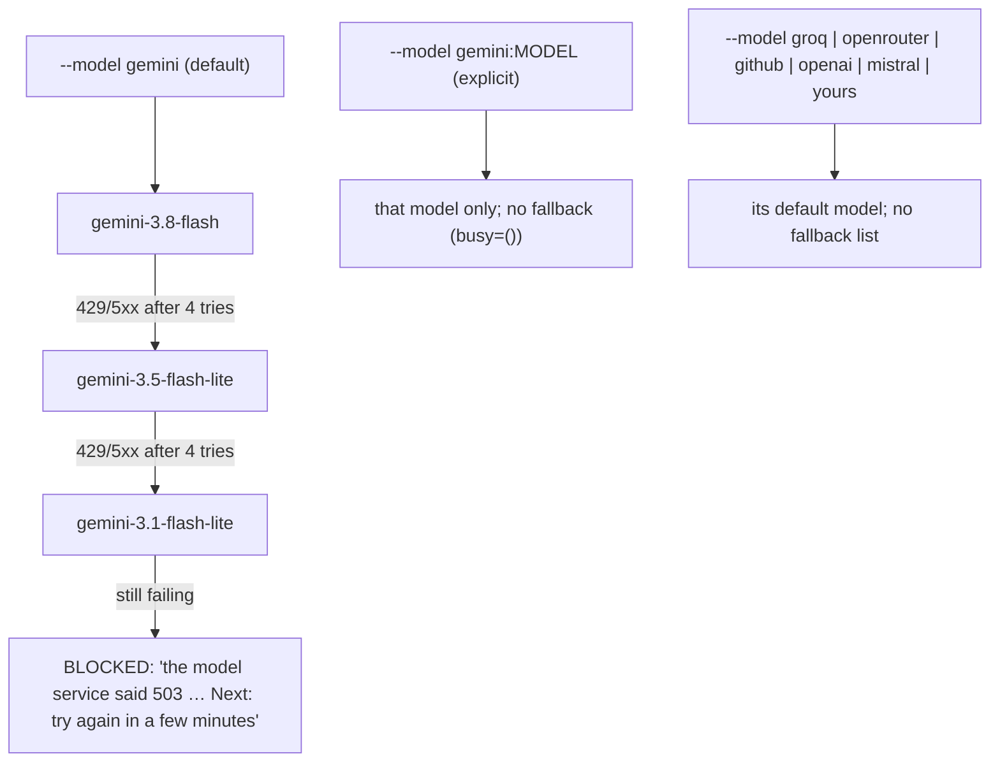

# 05 · FinOps and resource routing

**The cost model in one sentence.** All compute is on the developer's own computer. The only metered resource is the
model service, which is the free Gemini tier by default. There is no cloud infrastructure, so this repo has no
infrastructure bill.

## 1. Infrastructure and third-party routing

### 1.1 Where each workload runs

| Workload | Weight | Runs on | Limits | Code |
|---|---|---|---|---|
| Launcher: policy, approvals, logging, Git plumbing | light | host Python process | — | `agent/*.py` |
| Agent conversation | light (memory ∝ conversation) | agent container, `python:3.12-slim` | `HARDENED` + `_limits()`; context ≤ 200k chars (worker `BUDGET`) | `worker.WORKER` |
| File operations | light | file helper container (same image) | 30 s per answer, 10 MB per line | `tools.FILES`, `box.Session` |
| Agent-requested commands | medium | new container per command, project image | 600 s, min(3 GB, half RAM), ≤ 4 CPUs, 512 pids, 3 GB disk | `box.Box.run` |
| **Independent check** | **heavy** | 6–8 fresh volumes and containers in sequence (Python) | 1800 s total for the whole check | `checker.Checker` |
| Image build (first run per tree) | heavy, one-off | `docker build` with network | 1800 s | `image._build` |
| Disk measuring | light | root helper, one capability, 256 MB | — | `box.Box.look` |
| Model inference | external | model service over HTTPS | per-service calls/min; 180 s per reply | `provider.OpenAIFormat` |
| Dashboard | medium, opt-in | Grafana + Datasette containers | 512 MB each, 200 pids, read-only | `dashboard._common` |

**Container runs per Python check** (`checker.by_tests`): 1 baseline + 3 with the change + 2 proof-without, plus 2
regression repeats when a test that worked before fails now = **6 to 8**. Each run creates a volume, copies the files
in, runs, and removes everything. On the developer's machine, 57 `agent verify` runs took **26 s on average (6 s
min, 57 s max)** (read from `events.db`, 25–27 Nov 2026).

### 1.2 Provider routing and fallback chain



Source: `services.KNOWN` (`busy=("gemini-3.5-flash-lite", "gemini-3.1-flash-lite")`), and `screen.choose_model`
(`busy=() if rest else s.busy`). The switch is permanent for the rest of that process and prints
`Note: <old> cannot answer now (503); using <new> from now on`.

| Service | Default model | Calls / min | Who receives the code | Tested |
|---|---|---|---|---|
| gemini | gemini-3.8-flash | 5 | Google (free-tier data-use note) | ✅ |
| groq | llama-3.3-70b-versatile | 30 | Groq | — |
| openrouter | meta-llama/llama-3.3-70b-instruct:free | 20 | OpenRouter + model company (free-model data note) | — |
| github | openai/gpt-4.1-mini | 10 | GitHub (Microsoft) + model company | — |
| openai | gpt-4.1-mini | 30 | OpenAI (note: "each call costs money") | — |
| mistral | mistral-small-latest | 30 | Mistral AI | — |
| added with `agent key add` | given | 1–600 (default 10) | `--company` | — |

### 1.3 Retry policies

| Call | Retries | Backoff | Code |
|---|---|---|---|
| Model HTTP 429, 500, 502, 503, 504 | 3 more (4 total) | `max(Retry-After, 5·2^attempt + U(0,1))`, capped at 120 s | `provider._retry_after` |
| Model network error / timeout | 3 more | `2·2^attempt` s (2, 4, 8) | `provider._call` |
| Model 401/403 | none | — ("Next: agent key set SERVICE") | |
| Cut reply (`finish_reason: length`) | 2 more | none | `loop.Task._model`, `Limits.cut` |
| Checker FAILED | the agent gets 2 more tries | — | `Limits.tries = 3` |
| Cleanup | 4 attempts | 0, 0.5, 1, 2 s | `box.Box._remove_all` |
| Docker CLI calls | none; 60 s timeout → `BoxError` | — | `box.docker` |

### 1.4 Circuit breaking
There is **no circuit breaker object**. The equivalents are:
- **Fallback model switch.** After a busy failure the next model is used *for the rest of the session*, so the failing one is not hammered again.
- **Cool-down between runs.** A model that was busy or out of quota is written to `<data>/cooldown.json` for 10 minutes (`provider.COOL_SECONDS`). A later `agent` start goes straight to the next model in the chain, with a `Note:` line saying why. A broken or missing file is only a missing hint (`test_key.Service.test_a_busy_model_is_remembered_by_the_next_run`).
- **Hard task limits** (`Limits`), and the `Repeats` detector, which stops a task that calls the same thing over and over.
- **Watchdogs.** `Box._watch` polls every 50 ms for cancel or timeout and checks disk every 2 s. It kills the container on breach.

---

## 2. Cost controls and caching

### 2.1 Hard caps (per task unless noted)

| Cap | Value | Code |
|---|---|---|
| Model calls | 100 | `Limits.model_calls` |
| Tokens (sum of `usage.total_tokens`) | 2,000,000 | `Limits.tokens` |
| Active minutes (human wait excluded) | 45 | `Limits.minutes` |
| Tool calls | 1000 | `Limits.tool_calls` |
| Log bytes written by one task | 50 MB | `Limits.log_bytes` |
| Tries after FAILED | 2 | `Limits.tries = 3` |
| Request sent to the model | 3,000,000 chars | `loop.MAX_REQUEST` |
| Conversation kept by the worker | ~200,000 chars; older tool results over 200 chars are replaced by a placeholder; system, task and last 10 messages are always kept | `worker.WORKER` `shorten` |
| One tool result | 30,000 chars (half head, half tail) | `tools.MAX_RESULT` |
| One file read page | 400 lines or ~28,000 chars | `tools.Toolbox._page` |
| File the helper will read | 1 MB | `FILES.BIG` |
| `list` results | 500 names; walk stops at 20,000 entries | `FILES` |
| `search` | 50 hits; ≤ 100 MB scanned | `FILES` |
| Changed files per commit | 5 MB total | `gitsafe.MAX_CHANGE` |
| Project copy | 3 GB | `box.MAX_FILES` |
| Command output kept | 10 MB | `box.KEEP_OUTPUT` |
| Free disk to start | 8 GB | `doctor.NEED_FREE_GB` |
| Model calls per minute | per service (Gemini 5) | `provider.Limiter` |

### 2.2 Caches

| Cache | Key | Effect | Code |
|---|---|---|---|
| Project image | sha256 of the commit's tree | the same tree is never built twice | `image.tag` |
| Setup confirmation (`agent run`) | sha256 of image, command, model + setup file blob ids | the start screen shows "as last time" | `screen.fingerprint`, `remembered` |
| Docker limits, helper image id, image volumes | process lifetime | fewer `docker info/inspect` calls | `functools.cache` in `box.py` |
| Test durations (dev only) | `.git/coding-agent-v2-times` | longest tests first | `tests/run.py` |
| Passed check (dev only) | sha256 of files, Python, Docker, base image, Git | the pre-commit hook skips the tests for identical inputs | `./check`, `tests/run.py key` |

There is no Redis, CDN or HTTP response cache. **There is no prompt cache** either: every model call sends the full
(shortened) conversation. **[GAP / RECOMMENDED]** For providers that support prompt caching, keep `messages[0:2]`
(system + task) byte-stable. They already are, so caching would apply automatically where the provider offers it.

### 2.3 Primary cost drivers

| Driver | Measured on the developer's machine (from `events.db`, 8 live Gemini tasks, 25–27 Nov 2026) |
|---|---|
| Tokens per VERIFIED task | **9,170** (flash-lite, 8 calls, 170 s) and **10,529** (flash, 9 calls, 181 s) |
| Tokens per FAILED task (3 tries) | **36,951** (20 calls, 437 s) |
| Tasks BLOCKED by the service (busy or quota) | **3 of 8** |
| Model calls per minute | capped at 5 (free tier) → a 9-call task spends ≥ 96 s waiting on the limiter |
| Wall time of the check | ~26 s average per `verify` run |

Money cost per task: **$0 on the Gemini free tier.** On a paid model:

```
cost_per_task ≈ tokens_per_task × blended_price_per_token
             ≈ 10,000 × [FILL IN REAL NUMBER: provider $ per 1M tokens] / 1,000,000
```

Input and output tokens are recorded apart (`prompt` and `completion` in `model.replied`, from the service's
`usage`), so a paid model can be priced exactly:

```
cost_per_task = Σ prompt × input_price + Σ completion × output_price
```

The 8 live tasks above ran before this was recorded, so they have totals only. **[GAP / RECOMMENDED]** There is no
per-task dollar budget in `Limits` yet:

```python
# agent/loop.py
class Limits(NamedTuple):
    ...
    dollars: float = 0.0          # 0 = no budget (free tier)

# in Task._model, after a reply:
self.spent += reply.prompt * IN_PRICE.get(self.model.name, 0.0) + reply.completion * OUT_PRICE.get(self.model.name, 0.0)
if self.limits.dollars and self.spent > self.limits.dollars:
    raise Stopped(f"the budget of ${self.limits.dollars:g} is used up")
```

### 2.4 How to read real cost data yourself

```sql
-- in Datasette (agent dashboard → http://127.0.0.1:8001/events) or sqlite3 on a copy of events.db
select s.task,
       json_extract(s.body, '$.model')                                   as model,
       (select sum(json_extract(body, '$.tokens')) from event r
         where r.task = s.task and r.kind = 'model.replied')             as tokens,
       (select sum(json_extract(body, '$.prompt')) from event r
         where r.task = s.task and r.kind = 'model.replied')             as tokens_in,
       (select sum(json_extract(body, '$.completion')) from event r
         where r.task = s.task and r.kind = 'model.replied')             as tokens_out,
       (select count(*) from event r where r.task = s.task and r.kind = 'model.asked') as calls,
       (select json_extract(body, '$.state') from event r
         where r.task = s.task and r.kind = 'task.ended')                as state,
       round((select max(at) - min(at) from event r where r.task = s.task)) as seconds
from event s
where s.kind = 'task.started' and json_extract(s.body, '$.model') not in ('fake', 'recorded')
order by s.seq desc;
```

### 2.5 Local resource budget (what a developer pays in hardware)

| Resource | Need |
|---|---|
| Disk | ≥ 8 GB free to start; `python:3.12-slim` ~200 MB; language images 60–300 MB each; dashboard ~1 GB the first time |
| RAM | one container at a time at up to min(3 GB, half of Docker's RAM) |
| CPU | ≤ 4 cores per container |
| Time | ~1 min for the demo; ~3 min for a small live task, most of it limiter waits |
