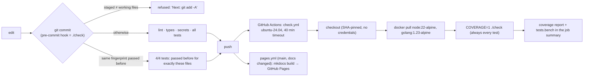

# 06 · Testing and CI regression

## 1. Testing and quality framework

### 1.1 The one command

```bash
./check            # lint → types → secret scan → every test; prints ALL CHECKS PASSED
```

| Stage | Tool | Where it runs | Fails on |
|---|---|---|---|
| 1/4 lint | `ruff check` with rules `E F I B UP S`, line length 120 | dev container: `--network=none --read-only --cap-drop=ALL --memory=1g`, repo mounted read-only | any finding |
| 2/4 types | `mypy agent`, `strict = true`, Python 3.11 | same container | any error |
| 3/4 secrets | `python3 -m agent.scan` | host | any rule in `scan.RULES` or blocked file name, in staged **and** working copies |
| 4/4 tests | `python3 -m tests.run` | host + real Docker | any job failing, **or a job that ran a different number of tests than were discovered** |
| after | `docker ps -aq --filter label=coding-agent-v2=check` | host | any container left |

The dev image is `coding-agent-v2/dev:<hash of Dockerfile>`. It is built from wheels that `./check` downloads on the
host (Docker Desktop's network can be slow), with `RUN --network=none`.

### 1.2 Test suites

All tests use `unittest`. Most are **integration tests against real Docker and real Git**. Only the model and the
Keychain are faked.

| File | Area | Kind | Notable cases |
|---|---|---|---|
| `tests/test_box.py` | containers, limits, copy, cleanup | integration (Docker) | no network/socket/home; fork, memory, output, disk floods; Ctrl+C right after a Docker call; hostile image labels |
| `tests/test_checker.py` | checker, verdicts, cheats | integration | `test_no_cheat_is_verified`; `test_known_limit_two_cheats_pass` (documents the 2 known misses); review findings that once gave a false VERIFIED |
| `tests/test_path.py` | the whole loop | end-to-end with `FakeModel` | request → VERIFIED; a lie does not help; limits, repetition, cut replies; hostile worker; no secret reaches the model or the log |
| `tests/test_policy.py` | rules, approvals, tools | unit + integration | forged rows, padding, bidi; approved action changed; injected command; links never followed |
| `tests/test_verify.py` | gitsafe + `agent verify` | integration (Git) | folder, index and branch untouched, no hook runs; colour settings; tags with the branch name |
| `tests/test_chat.py` | chat, follow-ups, `--continue` | end-to-end with a fake TTY | a follow-up without new work is not VERIFIED; Ctrl+C during the check |
| `tests/test_key.py` | Keychain, provider | unit + local fake HTTP server | key never in argv or on screen; part of the key at the edge; busy → lighter model; slow drip |
| `tests/test_services.py` | service registry | unit | https only; a changed file cannot send the key over http |
| `tests/test_log.py` | event log | integration (processes) | 20 kills lose nothing; two programs writing at once; every changed field found |
| `tests/test_mask.py` | masking | unit (property-style loops) | a secret at every cut position; known limit: changed forms |
| `tests/test_scan.py` | secret scan | unit | each rule finds its fake; staged-only secret found |
| `tests/test_junit.py` | JS/Go reports | unit + integration (node, golang images) | report disagreeing with the exit code; printed results do not count |
| `tests/test_image.py` | Dockerfile / requirements images | integration (builds) | "no" means nothing is built; verify takes the image from the base, not the branch |
| `tests/test_mcp.py` | MCP server | integration (subprocess) | same verdict as `agent verify`; malformed → error, not a crash; only JSON on stdout |
| `tests/test_dashboard.py` | dashboard | integration | log unchanged; changed log shown; every panel query runs; ports on 127.0.0.1 |
| `tests/test_demo.py` | demo, model-test | end-to-end | expected verdicts; recording complete and safe; `--keep` |
| `tests/test_screen.py` | `agent run` screen | end-to-end | one yes + one merge (NFR-4); plain vs live lines |
| `tests/test_doctor.py` | doctor | unit | old Python refused in one line; `__main__.py` parses on old Python |
| `tests/test_docs.py` | docs | unit | every `agent X` in the README exists; links resolve; no private paths, keys or emails; limits stated |
| `tests/test_check.py` | `./check` itself | integration | the hook does not repeat, but `./check` always runs everything; a test that does not run is a failure |

**Size:** 292 tests (the most recent commit message: "40 minutes for 292 tests" on CI). Locally `tests/run.py` runs
4 jobs at once. `CASE-STUDY.md` reports 15–25 minutes on the developer's Mac, at about 240 tests.

### 1.3 How to run

```bash
./check                                        # everything, as CI does
python3 -m tests.run                           # tests only, 4 parallel jobs
python3 -m unittest tests.test_policy -v       # one file
python3 -m unittest tests.test_checker.Python.test_no_cheat_is_verified
python3 -m agent.scan                          # secret scan only
python3 -m agent.demo                          # re-record demo/recording.jsonl after changing the prompt or tools
```

The test runner (`tests/run.py`):
- discovers tests and makes one job per test, or one per class when the class has `setUpClass`;
- orders jobs longest-first using `.git/coding-agent-v2-times`;
- runs each job as `python -m unittest <id>` and requires `Ran N tests` to equal the discovered count **and** `OK`, so a silently skipped or never-loaded test fails the build.

### 1.4 Quality metrics that exist

| Metric | How it is measured | Where |
|---|---|---|
| Cheat resistance | 7 cheat cases: never VERIFIED, except the 2 documented ones | `test_checker.Python.test_no_cheat_is_verified`, `test_known_limit_two_cheats_pass`; `agent demo` |
| Files untouched | byte comparison before and after | `test_box`, `test_verify` |
| Leftovers | 0 labelled containers and volumes after every run | `./check` final step; cleanup tests |
| Durability | 20 kills of the writer, 0 lost events | `test_log` |
| Human decisions per ordinary fix | counted: 1 start + 1 merge | `test_screen.test_an_ordinary_fix_needs_one_yes_here_and_one_merge_by_you` |
| Check latency | from the log: `verify.done.at - verify.started.at` | see [05-finops-and-resource-routing.md](05-finops-and-resource-routing.md) |
| Coverage of `agent/` | `COVERAGE=1` makes `tests/run.py` run each job under coverage.py; CI then runs `coverage combine` and `report` | CI job summary "Coverage of agent/" |
| Speed of one check | `python3 -m tests.bench`: 3 checks of the demo's honest fix in fresh containers; fails above 1.5× the saved median (`--save` saves it in `.git`) | local; CI prints it in the job summary. Developer's Mac: **11.3 s** median |

Coverage covers the launcher code that the tests import. Programs the tests start as separate processes (`python -m
agent …`) and code inside containers are not counted. **[GAP / RECOMMENDED]** There is no `--fail-under` threshold
yet. Set it a few points below the first CI number.

**[GAP / RECOMMENDED]**
- **Mutation testing is manual** (CASE-STUDY: "deliberate breaks of the code"). Template: `mutmut run --paths-to-mutate agent/checker.py,agent/policy.py` weekly.
- **No live-model test in CI** (no key in CI, by design). `agent model-test gemini` is run by hand. Its result goes to `<data>/models.json`.

### 1.5 Known edge-case failure modes

| Case | Behaviour | Status |
|---|---|---|
| Hard-coded answers for the tests | VERIFIED | known limit (README, `receipt.NOT_PROVEN`) |
| Objects whose `__eq__` always returns True | VERIFIED | known limit |
| A cheat that changes a single test from inside the test process, without reaching the canaries | may pass | known limit |
| Test helpers outside test folders that do not import unittest or pytest | not protected | known limit |
| Tests that fail rarely (< 1 in 3) | may pass | known limit; 3 repeats |
| JS, Go, Rust, Java | no canaries (`NOT CHECKED`) | known limit |
| Rust, Java | COMMAND-LEVEL only | known limit |
| Uncommitted work | not seen; the copy is of the last commit | by design; a note is printed |
| PID reuse after a crash | leftovers stay until that PID ends | `box.py:158` |
| Linux | key typed per session; Keychain tests skip storage | by design |

---

## 2. Fixtures, mocks and CI gates

### 2.1 Fixtures and fakes

| Fake | What it replaces | Code |
|---|---|---|
| `FakeModel(script)` | the model; a list of messages or callables | `agent/model.py` |
| `Replay(path)` + `demo/recording.jsonl` | the model, from a recording; `different` counts requests that no longer match | `agent/model.py`, `agent/demo.py` |
| `Recorder` | wraps a model and writes masked replies | `agent/model.py` |
| `call_message(name, reason, **args)` | builds one tool-call reply | `agent/model.py` |
| Local HTTP server (`FakeService`) | the provider: busy, slow, odd replies, redirects | `tests/test_key.py` |
| `CODING_AGENT_KEYCHAIN=/nonexistent/...` | the real Keychain, so no test can read the developer's key | `tests/__init__.py` |
| Temporary Git repos | real repositories built per test (`demo.project` and helpers) | most test files |
| Real Docker | **not mocked**; `python:3.12-slim`, `node:22-alpine`, `golang:1.23-alpine` | CI pulls the last two |

There is no test database; each test that needs a log creates its own SQLite file in a temporary directory.

### 2.2 Gates



- **Pre-commit hook** = `./check` (when invoked as `pre-commit`). It refuses when the index differs from the working files, because the working files are what gets tested. It may reuse a remembered pass **only** for an identical fingerprint (`tests/run.py key`: every tracked or untracked file, the Python version, `docker version`, the base image id, `git version`). It also fails when files change while the tests run.
- **CI** (`.github/workflows/check.yml`): runs on `push` and `pull_request`, with `permissions: contents: read`, and always runs the full suite.
- **Docs site** (`.github/workflows/pages.yml`): on a push to `main` that changes `docs/` or `mkdocs.yml`, MkDocs Material builds the site and deploys it to GitHub Pages. To preview it locally: `pip install mkdocs-material==9.8.2 && mkdocs serve`.
- **No product deployment pipeline.** There are no releases, packages or tags (README: "releases" are not built).

**[GAP / RECOMMENDED]**
- Branch protection on `main` requiring the `check` job. This is a GitHub setting and cannot be seen in the repo.
- A macOS CI job (`runs-on: macos-14`) for the Keychain paths. Docker on macOS runners needs Colima, so expect a slow job.
- `concurrency: { group: check-${{ github.ref }}, cancel-in-progress: true }` to save CI minutes on quick pushes.

### 2.3 Proving a refactor or dependency upgrade did not break anything
1. `./check` must pass. It is the same suite CI runs.
2. `agent demo` must print "The demo gave the expected results." (honest VERIFIED; weakened and broken FAILED; forged UNVERIFIABLE). Its exit code is 1 otherwise.
3. If the prompt or the tool list changed, re-record (`python3 -m agent.demo`) and confirm `Replay.different == 0` in a fresh demo run.
4. For a Python or Docker upgrade: the `tests/run.py key` fingerprint changes, so the hook cannot reuse an old pass.
5. Run `agent verify` on a branch *of this repo* made before and after the upgrade, and compare the two receipts' `steps`.
